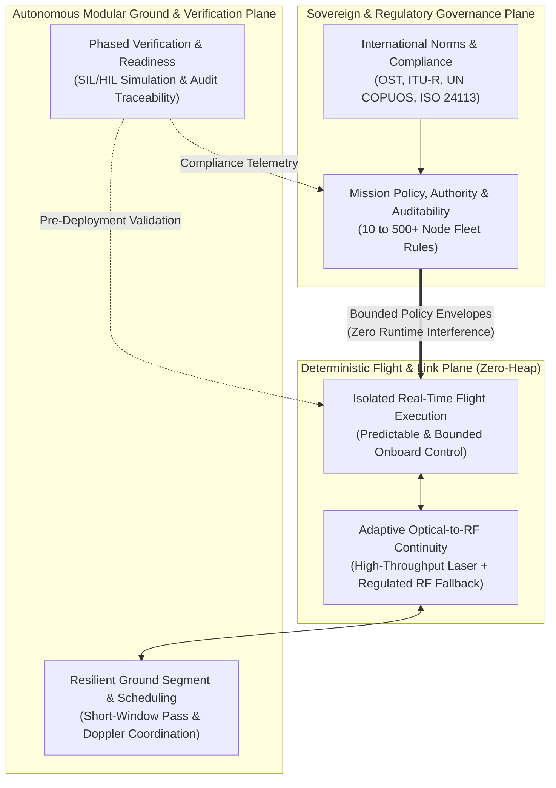

# GEONMI-MEMS Zero-Heap VLEO
## Sovereign Governance & Mission Architecture for Civilian and Commercial Very Low Earth Orbit Constellations

`#GEONMI-MEMS` `#ZeroHeapVLEO` `#SpaceGovernance` `#AutonomousConstellations` `#OpticalRFComms` `#CivilianSpace` `#CommercialSpace` `#DeterministicSystems`

---

### Executive Overview & Architectural Value Proposition

**GEONMI-MEMS Zero-Heap VLEO (Version 20)** is a civilian and commercial space ecosystem architecture designed to govern and coordinate Very Low Earth Orbit (VLEO) constellations scaling from **10 to 500+ orbital nodes**. Representing the sovereign governance and mission-level culmination of the GEONMI-MEMS evolutionary series—building upon foundational deterministic flight kernels, ground-to-space TT&C cores (VLEO-16), Doppler contention orchestrators (VLEO-17), and off-grid ground blueprints (VLEO-18)—this framework addresses the demanding VLEO regime, where dynamic atmospheric drag, thermal gradients, rapid orbital velocities, and short contact windows challenge traditional ground-centric control.

The ecosystem emphasizes predictable execution, resilient link continuity, disciplined governance boundaries, and clear accountability across space and ground segments. Rather than exposing proprietary implementation internals or internal trade secrets, this public showcase presents the **high-level mission outcomes, operational value, and architectural discipline** of the ecosystem. The framework separates high-level governance, compliance boundaries, and operational authority from low-level flight execution, enabling constellations to remain responsive under urgent conditions while preserving strict regulatory and safety alignment.

---

### High-Level Conceptual Architecture (Abstraction Layer)

The following conceptual abstraction illustrates the strict boundary separation between regulatory/sovereign governance, deterministic onboard execution, and adaptive space-to-ground continuity:

---

### Alignment with Global Space Standards, Protocols, International Agreements & Engineering Norms

The GEONMI-MEMS Zero-Heap VLEO architecture is structured to align its governance and operational principles with established international space norms, telecommunications frameworks, and recognized engineering standards, including:

- **International Space & Orbital Sustainability Frameworks:** Alignment with the United Nations **Outer Space Treaty (OST)** principles of peaceful exploration and use, the **Registration Convention**, and **UN COPUOS Space Debris Mitigation Guidelines**, alongside orbital conjunction awareness and responsible end-of-life / de-orbit planning in low altitudes.
- **Global Telecommunications & Non-Interference Protocols:** Adherence to **International Telecommunication Union (ITU)** Radio Regulations (**ITU-R**), spectrum coordination principles, harmful non-interference obligations, and orderly transition between high-capacity optical/laser links and Radio Frequency (**RF**) backup channels within authorized envelopes.
- **Recognized Space & Systems Engineering Standards:** Alignment with established engineering methodologies and quality/safety disciplines reflected in **ECSS** (European Cooperation for Space Standardization), **ISO** space systems and quality standards (such as **ISO 24113** for space debris mitigation and **ISO 9001** quality management principles), and **CCSDS** (Consultative Committee for Space Data Systems) space-to-ground interoperability concepts.

---

### Technical & Developmental Perspective

From a technical and developmental standpoint, scaling a VLEO constellation from tens of satellites to **500+ nodes** requires coordinated progression across software determinism, spacecraft physical limits, link adaptability, ground station resilience, and structured verification:

- **Deterministic & Resource-Disciplined Execution:** High-level governance policies and legal-operational rules are maintained distinctly from real-time flight execution so mission policies evolve cleanly without compromising predictability or stability on board.
- **Multi-Domain Coordination Without Bottlenecks:** The ecosystem connects space segments, optical/RF communication links, autonomous modular ground infrastructure, and verification workflows through clearly defined roles and boundaries, allowing time-critical safety responses to remain fast and reliable while routine tasks stay organized.
- **Adaptive Optical-to-RF Continuity:** High-throughput optical/laser communications support high-capacity transfer under favorable conditions, while controlled RF fallback preserves resilient connectivity when atmospheric or pointing conditions shift—always bounded by non-interference and regulatory rules.
- **Phased Development & Verification Lifecycle:** Development progresses systematically from architectural modeling and software-in-the-loop/hardware-in-the-loop (**SIL/HIL**) simulation to staged constellation scaling, auditability, and formal readiness reviews before operational deployment.

---

### Commercial & Financial Perspective (Illustrative Context)

From a commercial and operational scalability standpoint, autonomous governance and resilient link management in VLEO aim to support scalable civilian and commercial applications—such as low-latency data relay, environmental and earth observation support, infrastructure monitoring, and resilient communications—while helping manage operational overhead as fleet size grows.

Potential commercial value drivers include:
- **Scalable Fleet Economics:** Enabling a single governance and operational model to scale across growing node counts without linear growth in manual sequential intervention.
- **Link & Operational Continuity:** Reducing service interruptions through structured optical/RF link resilience, automated ground readiness coordination, and disciplined exception handling.
- **Auditability & Partner Confidence:** Providing clear governance boundaries, traceability, and compliance alignment that support commercial partnerships, insurers, and regulatory stakeholders.

---

### Disclaimer, Sole Ownership, Legal Notice & Contact

- **Independent Individual Effort — Civilian & Commercial Scope Only:**  
  This work is produced through an **independent individual effort** and is not affiliated with, sponsored by, endorsed by, or acting on behalf of any company, corporate entity, organization, or institution. The GEONMI-MEMS Zero-Heap VLEO ecosystem and framework are strictly **civilian and commercial in nature** and have **no military, defense, weapons, or combat purpose or application whatsoever**.

- **Indicative Financial Estimates & Generative Visual Simulations:**  
  All financial figures and numerical projections are indicative estimates provided solely for explanation and are **not a binding rule or guarantee** of any kind. Furthermore, all visual models are **generative, hypothetical simulations** created purely to facilitate understanding and clarify concepts.

- **Sole Owner, Intellectual Property & Official Legal Warning:**  
  **Mohamed Talal Kadri**—Legal-Engineering Researcher and Architect—is the **Sole Owner** of this work, architecture, brand/ecosystem concept, and related materials. **Copyright (c) 2026 Mohamed Talal Kadri. All Rights Reserved.** Any unauthorized reproduction, distribution, modification, public display, misappropriation, false claim of ownership, or commercial exploitation without prior written permission from the Sole Owner is strictly prohibited and may result in civil and legal action under applicable laws.

- **Private Repository (NDA) & Official Contact:**  
  The core technical and governance repository is **private and closed**, accessible strictly under an executed **Non-Disclosure Agreement (NDA)** and authorized review. For legitimate technical and commercial inquiries or NDA requests, contact:
  - `kadritalal38@gmail.com`
  - `talal.works38@gmail.com`
